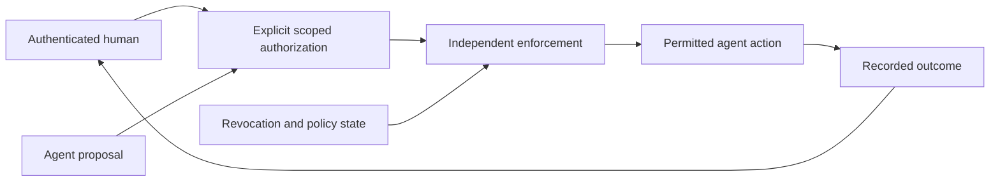

# Architecture — Acing IU: Genesis

**Human Authority for the Age of Artificial Intelligence**

**Security by Foundation. Personal by Choice. Engineered for Trust.**

Genesis is an emerging human-authority platform for AI-assisted operations. IU means Interface User. A person is the source of delegated authority; neither an agent nor an AI provider can authorize itself. The platform remains in development. The diagram below is a target, not evidence that all components are integrated or production-ready.

## Target authority lifecycle

**Human → Authorization → Independent Enforcement → Agent Action → Recorded Outcome**

Before an effect is committed, independent server-side enforcement must establish the effective authorization, including its actor, scope, current policy and revocation state. Browser controls and model assertions are not enforcement. Unknown or unavailable authority must deny the action.

| Boundary | Target requirement | Current evidence limit |
|---|---|---|
| Human/session → authorization | Authenticated human and reviewer identity; expiration, revocation and safe recovery | Identity source exists; end-to-end session and approval behavior not validated here. |
| Agent → protected operation | Distinct agent identity bound to the exact delegated permission | Integrated authority path not established in the inspected checkout. |
| Authorization → enforcement | Human, agent, tenant, application, resource, operation, input constraints, resource version, expiry, usage cap, revocation, approval context, policy version | Contract and race/negative-path evidence required before claiming enforcement. |
| Enforcement → effect | Revalidate at commit; idempotent retries and explicit uncertain outcomes | No cross-system transaction or rollback guarantee claimed. |
| Effect → evidence | Authenticated durable event with decision, correlation, actor, resource, policy, and outcome; sensitive values minimized | Database persistence alone does not establish tamper evidence or immutable audit. |

Revocation must block subsequent uncommitted operations within documented synchronization limits. It cannot undo an already completed external effect. Outages, partial failures, duplicate execution, and unknown retry results require explicit outcomes rather than fabricated success.

## Implementation inventory

The canonical backend root is `backend/`. Source presence is classified separately from independently validated operation; see [CAPABILITY_REGISTER.md](docs/CAPABILITY_REGISTER.md).

| Area | Location | Classification and limitations |
|---|---|---|
| Identity API | `backend/Identity/src/AcingIU.Identity.Api/` | Implemented but not independently validated here; password/JWT/MFA/session functionality needs current behavior evidence. |
| DeviceTrust API | `backend/DeviceTrust/src/AcingIU.DeviceTrust.Api/` | Implemented but not independently validated here; documented object-level authorization gap requires remediation. Scoring is not attestation. |
| Shared kernel and unit tests | `backend/SharedKernel/`, `tests/Identity.UnitTests/`, `tests/DeviceTrust.UnitTests/` | Source/test projects present; a test's existence is not a current pass. |
| Policy and legacy Audit | `backend/Security/`, `backend/Audit/` | Not in canonical solution. Legacy Audit stores demo events in memory and prints SQL strings; it does not execute those strings or persist them. Runtime exposure and authorization must be reconciled before use. |
| Operator frontend | `frontend/` | Simulator; browser fixture state cannot establish server-side authority. |
| PostgreSQL/Redis and API stack | `infrastructure/docker-compose.yml`, `infrastructure/postgres/init/` | Development configuration implemented; fresh isolated migration, health, and functional results required. |
| Human-authority prototypes | Remote development PRs | PRs #161–167 confirmed open drafts on 2026-10-27; #165 is stacked on #164. Implementation exists on PR heads, not integrated into master; independent runtime validation and review remain required. |
| AI provider adapter | No validated governed adapter established in this baseline | Planned; use deterministic mocks until provider and data governance are approved. |

`acing-iu/backend/` is a frozen duplicate and `installer/payload/platform/backend/` is generated payload. Do not develop or consolidate those copies independently. Existing architecture decisions and historical evidence retain their recorded context.

## Supporting security and Android research

These components support research into device security and governed administration. They are not the primary product identity and do not independently prove human-authority enforcement.

| Research area | Location | Maturity |
|---|---|---|
| Guardian orchestration | `system/security/guardian/core/GuardianService.kt` | Experimental |
| Software vault | `system/security/guardian/core/AcingVaultEmulator.kt` | Simulator; in-process software, not hardware-backed storage |
| Identity/trust foundations | `system/security/guardian/identity/`, `system/security/guardian/trust/` | Experimental; device integration unverified |
| Boot/init and auth scripts | `system/security/guardian/boot/`, `auth/`, `iu_security/` | Experimental; no verified boot or rooting guarantee |
| Threat-engine sources | `system/security/guardian/threat/` | Experimental stubs; not a validated antivirus product |
| Policy/dashboard research | `system/security/guardian/policy/`, `dashboard/` | Experimental |
| Android app | `app/` | Scaffold/simulator-level evidence; device operations remain safety-gated |

Hardware root of trust, Samsung Knox integration/certification, and independently certified security are not established capabilities. Preserve the [Android safety gates](docs/adr/ADR-006-android-and-firmware-safety.md).

## Build, services, and validation

`backend/AcingIU.sln` selects Identity, DeviceTrust, SharedKernel and their unit-test projects. CI uses .NET 8 and Node.js 22. The frontend uses a frozen npm lockfile installation. Compose definitions exist under `infrastructure/`; older statements that no containers or health endpoints exist are stale. Runtime health and migrations still require validation.

The baseline Guardian wrapper refers to an absent `system/security/guardian/build/` directory. Restoring that build is distinct from ensuring `build.sh` reports failures. Root `validate-premerge.sh` can skip Kotlin compilation, misses infrastructure Compose when looking only at root paths, and does not exercise the API health endpoints. Its zero exit alone cannot establish readiness.

Required authority acceptance evidence includes absent/expired/revoked/exhausted permission denial, cross-tenant/resource access denial, agent substitution denial, stale approval/context/version denial, session expiry, concurrent approval/revocation, duplicate execution, backend outage, partial failure, and retry after uncertain results. These are requirements, not executed tests.

## Governing decisions and release limits

- [Repository and path governance](docs/governance/REPOSITORY_GOVERNANCE.md)
- [Data and audit boundaries](docs/adr/ADR-005-data-and-audit-boundaries.md)
- [AI and external API governance](docs/adr/ADR-007-ai-provider-governance.md)
- [Release provenance and recovery](docs/adr/ADR-008-release-provenance-and-recovery.md)
- [Security policy](SECURITY.md) and [threat model](THREAT_MODEL.md)

No deployment, release, public metadata update, permission change, or merge is authorized by an architecture document. Validation evidence must identify its commit, environment, command, status, and limitations.
