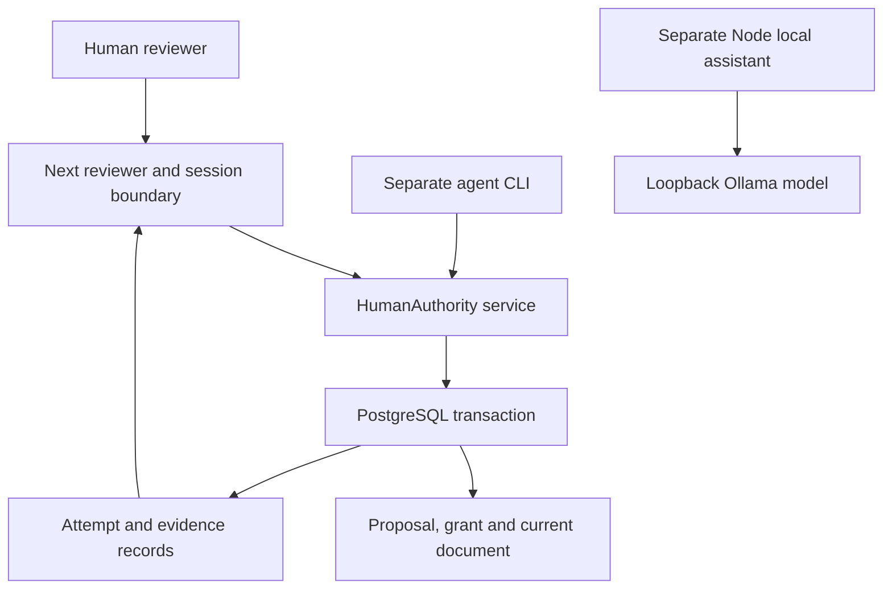

# Master directive: verified execution baseline

Recorded November 22, 2026 (America/Los_Angeles). Founder: Micki Hart.
IU means Interface User. Proposed entity Acing Gen LLC is not verified as
registered. Motto: “Security by Foundation. Personal by Choice. Engineered for Trust.”

## Baselines and preservation

GitHub metadata and a fresh clone establish canonical repository
`AcingTime420/Acing-IU-Genesis`, default branch `master`, commit
`4cf3181951ddc3366a193d49cb8ca32dce346bf7`. No Windows workspace was accessed in
this run; its branches, uncommitted work and installed repair state remain unknown.
The new checkout had no uncommitted work. No existing branch was reset or merged.

The integrated candidate inspected locally is #248 at
`b8fbaf1a7cd054d22c9bbb0acf57ceabf6484aac`, tree
`5ec88baa9e60f46930b8a1794a88d34afedf3d53`. It is an unmerged candidate, not the
default branch or production deployment. The distinct local assistant candidate
is `5a7be09738a604d27d7df67b6964023c7d707263` on
`prototype/local-genesis-assistant`. Preserve both implementation histories.

All requested PRs were individually fetched: all remain **open drafts, unmerged**.
GitHub reported them mergeable at inspection; this does not establish safe integration.

| PR | Head commit | Base | Scope |
|---|---|---|---|
| #161 | a73f9b569ab07a915841eac675448806c8ac2b67 | master | Mock human-authority UI |
| #163 | e2e2de0031cc79f4597dd93253489499e107fb22 | master | Transactional authority prototype |
| #164 | a2e72020b311b93a14e14a7a56202b65fe3c66a1 | master | Integrated local reviewer |
| #165 | a72349737cd6424c2f5f9bb82de1c11a5881e7c8 | #164 | Stale-session action binding |
| #191 | de97bddf1790cc28f022dff158699434e0f6b67d | #186 | Historical Zod dependency repair |
| #222 | 9d0876aa7d9794f9547d57fe42a2a7e980cd8cda | #165 | Reject stale first approval |
| #223 | e200b031b59126f5034b556022614eaa55f04080 | #222 | Connected workflow and Windows coverage |

Newer candidates found by current PR search: #245 (stabilization), #247 (anonymous
readiness privacy), #248 (API contract). Their stack is #223 → #245 → #247 → #248.
The old Gradle permission failure is already repaired in that stack; do not
generate another duplicate wrapper-mode PR. Documentation candidates #241/#242
and local assistant #220 require reconciliation rather than blind merging.

## Architecture and dependency boundaries

ADR-003 identifies `backend/` as canonical, `acing-iu/backend/` as frozen legacy,
and installer payload as generated content. Do not hand-edit generated mirrors.
The candidate uses .NET 10 for isolated HumanAuthority and test hosts; other
solution projects retain their own target frameworks. Frontend declares Next
16.4.6. Neither version should be inferred from historical PR #223.

The local assistant has no established connection to the durable authority
service. Its in-memory policy demonstration must not become a second production
authority source. Integration should reuse inference only, with untrusted
structured proposal creation and human authorization in the durable service.
Model output must never supply approval credentials or control grant creation.

| Target layer | Existing source | Current limit |
|---|---|---|
| Interface User | `frontend/src/app/genesis`, `frontend/src/app/api/genesis/route.ts` | Local prototype, not production identity |
| Intelligence | Separate branch `backend/LocalAssistant` | Historical real inference, no durable integration |
| Evidence | Authority receipts and frontend inspection | No general factual claim-verification engine |
| Authority | `backend/HumanAuthority/AuthorityDatabase.cs`, endpoints | Exact append to owned document; no organizations |
| Execution | Authority database transaction and separate agent CLI | Internal document effect only |
| Accountability | `database/migrations/001_human_authority.sql` | Durable records; no validated cryptographic chain/anchor |
| Infrastructure | PostgreSQL, CI, containers, local scripts | No completed production recovery/operations gate |

Revocation and execution serialize through transactional checks. A revocation
that commits before a new execution's authoritative grant check must deny that
execution. Execution that wins the serialization order may complete; revocation
does not undo its effect. Replaying a completed idempotent attempt returns its
historical result without a new effect. Do not promise cancellation of an already
committed action or universal wall-clock immediacy.

## Evidence inspected versus rerun

GitHub Actions records fetched for exact #248 head report success:

- [Clean-clone CI 44861144140](https://github.com/AcingTime420/Acing-IU-Genesis/actions/runs/44861144140).
- [Security/dependency review 44861144119](https://github.com/AcingTime420/Acing-IU-Genesis/actions/runs/44861144119).
- [Repository integrity 44861144080](https://github.com/AcingTime420/Acing-IU-Genesis/actions/runs/44861144080).
- [Gradle submission 44861118894](https://github.com/AcingTime420/Acing-IU-Genesis/actions/runs/44861118894).
- [NuGet submission 44861119569](https://github.com/AcingTime420/Acing-IU-Genesis/actions/runs/44861119569).

These are inspected historical status records, not tests rerun here, fresh
dependency-alert clearance or independent human review. This environment has
Node 24.22.3 and Python 3.12.14; `dotnet` and `psql` were unavailable on PATH.
No backend/database or full application validation was executed in this run.
Open issue #246 requests independent volunteer review; invitation text or sent
outreach does not establish an accepted reviewer or completed review.

## WebXR repair reconciliation

The named repair ZIP was found and inspected without applying it. It contains
six files: config regression test, config patch, environment handoff, prior config,
setup script and repaired `src/server/config.ts`. No complete application,
package manifest, lockfile, Git history or runner-platform metadata is included.
Its standalone configuration suite was rerun on Node 24.22.3: **10 passed**.
This verifies those configuration cases only.

The handoff identifies AI Studio work, npm preview logs and a failed full export.
It does not establish source lineage to the primary repository, installation on
Windows, a resolved Android runner, successful full UI, PostgreSQL validation or
a supported platform conversion. Therefore preserve it as a separate partial
repair. Full source export and destination platform inspection remain blocked
by unavailable source/workspace access. No Gradle stubs or APK claims are justified.
The primary repository does contain a real Android/Gradle project; do not remove
that project to repair an external WebXR runner mismatch.

## Decisions, risks and ordered work

1. Preserve #248 and local-assistant histories. Review the stacked deltas in order,
   including overlaps with #191/#220/#241/#242 and DeviceTrust repair candidates.
2. Resolve independent human review of the authority/Windows/ownership boundaries.
   AI implementation and separate AI review are not human certification.
3. Specify reimbursement as a new typed internal operation: integer minor-unit
   amount, currency, project, category, authenticated manager, resource version,
   organization, expiration and exact approval fingerprint. Retain append tests.
   No money movement or banking adapter belongs in the initial operation.
4. Implement organization membership/ownership and cross-tenant denial tests
   alongside that operation. Current per-document ownership does not satisfy it.
5. Connect the existing local inference adapter to proposal creation only; measure
   current hardware and model quality/license before selecting a default model.
   Historical measured Qwen 2.5 1.5B Q4_K_M CPU inference used approximately
   986 MB weights / 1.17 GB loaded on Ryzen 3 5425U with 11.3 GiB RAM. That is
   feasibility evidence, not present resource availability or adequate accuracy.
6. Establish production identity/session recovery, explicit retention/privacy,
   key custody and tamper-evidence design, backup/restore exercises, incident
   handling and deployment rollback before production or external pilot claims.

Immediate risks: broad unmerged stack; stale default-branch documentation; no
organization isolation; no cryptographically authenticated authority evidence;
separate ephemeral AI demo; unresolved external WebXR export; incomplete real
identity/recovery/operations. No production readiness, legal registration,
customer demand, revenue, attestation or verified device executor is asserted.

Legal formation, ownership assignments, license/model compliance and commercial
validation remain separate research/delivery work. This engineering baseline
neither supplies legal conclusions nor spends funds or files documents.

## Reproducible inventory

Run `python3 scripts/genesis-inventory.py --ref HEAD` (Windows: `py -3` instead
of `python3`) from the candidate. The script reports pinned Git source metadata,
framework declarations, workflow/test/migration paths and whether the working
tree is dirty. It performs no fetch, reads no .env/settings or file contents from
the working tree, and never interprets source presence as passing validation.
Use a separate private output file if retaining its JSON; local branch names and
tracked paths can disclose project structure. Recheck GitHub independently for
current PR/check status.

This change's local checks: inventory succeeded against both pinned master and
candidate, preserving dirty work; a disposable Git fixture confirmed pinned
manifest reads despite malformed working-tree changes, no .env content collection,
invalid-ref failure, and malformed committed-manifest failure. Claim-surface and
whitespace checks passed. Separate AI review is a consistency check, not an
independent human security review. No runtime service code was changed.
